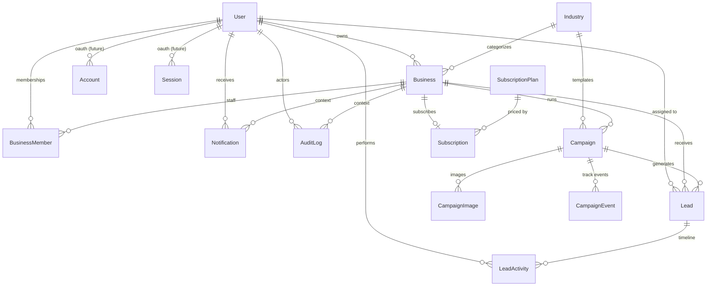

# CampaignHub — Database Design

**Database:** PostgreSQL 14+ · **ORM:** Prisma 6 · **IDs:** UUID (`uuid()` default) · **Money:** integer minor units (paise, INR) · **Timestamps:** UTC

## 1. Entity relationship diagram

## 2. Entities

### User
Platform identity. `email` unique. `passwordHash` (scrypt, nullable for future OAuth-only users). `isPlatformAdmin` gates `/admin`. `isActive` allows disabling accounts without deletion.

### Account / Session / VerificationToken
Auth.js standard tables, included for future OAuth/email-verification flows. JWT strategy is used today; these tables are unused until then.

### Industry
Catalog seeded with 8 rows: `real-estate`, `finance-loans`, `insurance`, `education-coaching`, `healthcare`, `retail-ecommerce`, `travel-tourism`, `other`. `slug` unique; `isActive` + `sortOrder` drive dashboard selects and marketing page. **New industries = new rows, no code changes.**

### Business
Tenant root. `slug` unique (for future public business pages). `ownerId` → User (creator). `industryId` nullable (onboarding may complete later; `SetNull` on industry deletion). `onboardingCompletedAt` drives onboarding UX. `status`: `ACTIVE` | `SUSPENDED` (platform admin action).

### BusinessMember
Membership + RBAC. `role`: `OWNER` | `ADMIN` | `MEMBER`. `status`: `ACTIVE` | `INVITED` | `REVOKED`. Invitations: `invitationEmail` + unique `invitationToken` + `invitationExpiresAt` (7-day TTL enforced in the service); `userId` null until the invitee registers. Unique `(businessId, userId)` prevents duplicate memberships. Invitations can never grant `OWNER`.

### SubscriptionPlan / Subscription
Plans seeded: Starter ₹999, Growth ₹2,499, Scale ₹5,999 per month (amount in paise: 99900 / 249900 / 599900). `features` JSON for plan feature lists (marketing copy). `Subscription` is 1:1 with business (`businessId` unique). `status`: `TRIALING` | `ACTIVE` | `PAST_DUE` | `CANCELLED` | `EXPIRED`. No payment execution in MVP — state changes are administrative.

### Campaign
Tenant-owned via `businessId`. Public URL slug unique (`/c/{slug}`); the slug is generated once from the name at creation and stays stable on rename so shared links keep working. Two content groups: promotional (`headline`, `promoDescription`, `productDetails`, `offerDetails`, `price` paise + `priceDisplay` free text for ranges like "₹85 Lakhs onwards", `videoUrl`, `ctaType`, contact fields) and targeting (`targetLocation`, `targetAudience`, `ageRangeMin/Max`, `interests`). Lifecycle: `status` `DRAFT`→`ACTIVE`→`PAUSED`/`COMPLETED`→`ARCHIVED`; `publishedAt`/`completedAt` audit milestones. Publishing requires a headline, description, one contact channel and a non-past end date. `ARCHIVED` is terminal and read-only. Only `ACTIVE` campaigns of `ACTIVE` businesses resolve publicly. Creation is limited by the plan's `campaignLimit` (non-archived rows only; Starter 1, Growth 5, Scale unlimited). `createdById` records the author.

### CampaignImage
Ordered images per campaign (`sortOrder`); `url` from storage adapter (local `/uploads/...` or GCS). Maximum 8 images per campaign; uploads are validated (JPG/PNG/WebP ≤5 MB) before anything is written, and the first image becomes the landing-page cover. Stored under `businesses/{businessId}/campaigns/{campaignId}/`.

### CampaignEvent
Append-only analytics events. `type`: `PAGE_VIEW` | `FORM_SUBMIT`. `visitorId` = anonymous UUID cookie set on first campaign-page visit — powers unique-visitor counts (`COUNT(DISTINCT visitorId)`). UTM columns captured from the landing URL; `referrer`, `userAgent`, `ipAddress` for abuse analysis (never shown to businesses). No unique constraint: dedupe of "unique visitors" happens at query time by `visitorId`; client also sends at most one event per visitor per day per campaign (cookie guard, Phase 5).

### Lead
Enquiry record scoped by `businessId` (+ nullable `campaignId`, `SetNull` if campaign deleted — the lead survives with source data intact). Contact: `name`, `phone` (required), `email`, `city`. `status`: `NEW` | `CONTACTED` | `INTERESTED` | `QUALIFIED` | `CONVERTED` | `LOST`. `assignedToId` → User. Consent: `consentGiven` + `consentText` (the exact notice shown). UTM + `visitorId` link back to CampaignEvent for funnel analysis. `nextFollowUpAt`, `lastContactedAt`, `convertedAt`, `lostAt` support follow-up workflows. Duplicate handling: soft — service checks same `phone` + `campaignId` within 24h before creating a new lead (indexed, not a hard constraint, since repeat enquiries over time are legitimate).

### LeadActivity
Timeline: `type` `CREATED` | `STATUS_CHANGED` | `NOTE_ADDED` | `ASSIGNED` | `FOLLOW_UP_SCHEDULED` | `FOLLOW_UP_COMPLETED` | `CONTACT_ATTEMPTED`; `fromStatus`/`toStatus`, `note`, `scheduledFor`, `metadata` JSON.

### Notification
In-app notifications per user; `linkUrl` routes to the relevant record; `isRead`/`readAt` for badge counts.

### AuditLog
Append-only security trail: `action` (e.g. `auth.login`, `campaign.published`, `admin.business.suspended`), `entityType`/`entityId`, `metadata` JSON, `ipAddress`. Written by services.

### RateLimitLog
Sliding-window counters for public endpoints (enquiry submit, login, register): rows keyed `"{scope}:{identifier}"` (e.g. `enquiry:1.2.3.4`). Old rows are pruned opportunistically.

## 3. Enums

`UserRole`, `MemberStatus`, `BusinessStatus`, `PlanInterval` (MONTHLY/YEARLY), `SubscriptionStatus`, `CampaignObjective` (AWARENESS/LEAD_GENERATION/SALES/APPOINTMENT_BOOKING/PROMOTION), `CampaignStatus`, `CtaType` (ENQUIRE_NOW/CONTACT_US/BOOK_APPOINTMENT/REQUEST_CALLBACK/GET_QUOTE/SCHEDULE_VISIT), `CampaignEventType`, `LeadStatus`, `LeadSource` (CAMPAIGN_PAGE/DIRECT/ORGANIC/SOCIAL/EMAIL/REFERRAL/OTHER), `LeadActivityType`, `NotificationType`.

## 4. Indexes & constraints (summary)

| Table | Index / constraint | Purpose |
|---|---|---|
| User | `email` UNIQUE | login lookup |
| Business | `slug` UNIQUE, `ownerId`, `industryId`, `status` | ownership + catalog |
| BusinessMember | `UNIQUE(businessId, userId)`, `invitationToken` UNIQUE, `(businessId, status)`, `invitationEmail` | membership integrity + invites |
| Campaign | `slug` UNIQUE, `(businessId, status)`, `(status, publishedAt)`, `industryId` | public URL, tenant lists, public listings |
| CampaignImage | `(campaignId, sortOrder)` | ordered gallery |
| CampaignEvent | `(campaignId, occurredAt)`, `(campaignId, type, occurredAt)` | analytics range scans |
| Lead | `(businessId, status)`, `(businessId, createdAt)`, `(campaignId, createdAt)`, `(assignedToId, status)`, `(businessId, phone, createdAt)`, `phone` | dashboard filters, dedupe check, assignment queues |
| LeadActivity | `(leadId, createdAt)` | timeline |
| Notification | `(userId, isRead, createdAt)`, `(businessId, createdAt)` | unread badge, per-business |
| AuditLog | `(businessId, createdAt)`, `(actorId, createdAt)`, `(action, createdAt)` | review trails |
| RateLimitLog | `(key, createdAt)` | sliding window |
| Subscription | `businessId` UNIQUE | one subscription per business |
| SubscriptionPlan | `slug` UNIQUE, `(isActive, sortOrder)` | plan catalog |

All tables carry `createdAt`; mutable rows carry `updatedAt`. Deletes cascade from `Business` down (campaigns → images/events, leads → activities) except where history must survive: `Industry` and `Campaign` deletions set leads' FK to null, `User` deletions are restricted when referenced as campaign author or business owner.

## 5. Tenant isolation

- Every business-owned row (`BusinessMember`, `Campaign`, `CampaignImage`, `Lead`, `LeadActivity`, `Notification`, `Subscription`, `AuditLog`) carries `businessId`.
- All tenant queries flow through repositories that receive `businessId` from the authenticated session — see `docs/ARCHITECTURE.md` §4.
- Public pages (`/c/[slug]`) look up campaigns by **slug only** and render only published data (`ACTIVE` campaign + `ACTIVE` business); no tenant context is exposed. Owner previews at `/preview/campaigns/[id]` are authenticated and tenant-scoped.

## 6. Migrations & seed

- Migrations live in `prisma/migrations/`, generated with `prisma migrate dev`, applied in CI/deploy with `prisma migrate deploy`. `0001_init` was generated offline from the schema (`prisma migrate diff`) so the repo is reproducible before any live database is attached.
- `prisma/seed.ts` (idempotent upserts): 8 industries, 3 plans, a platform admin (credentials from `ADMIN_EMAIL`/`ADMIN_PASSWORD` env), plus a demo business ("Sri Green Realty", real estate, Hyderabad) with an OWNER, a MEMBER, two campaigns (one active with the example slug `luxury-apartments-hyderabad`), leads across all statuses, lead activities, campaign events over 14 days, and a trial subscription. Demo passwords come from env (`DEMO_OWNER_PASSWORD`, `DEMO_MEMBER_PASSWORD`) — nothing real is hardcoded.

## 7. Growth notes

- `CampaignEvent` is the only high-volume table: append-only, indexed by `(campaignId, occurredAt)`; Phase 5 adds a daily roll-up summary if scans grow, keeping raw events for audits.
- UUID PKs keep IDs non-enumerable across the public surface.
- Prisma connection pooling sized for Cloud SQL in Phase 8 config.
